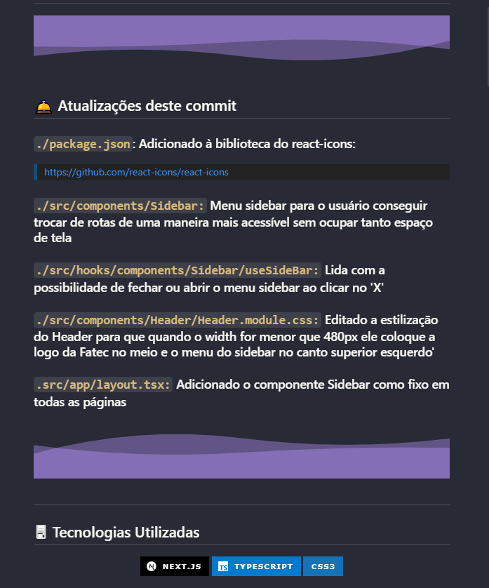
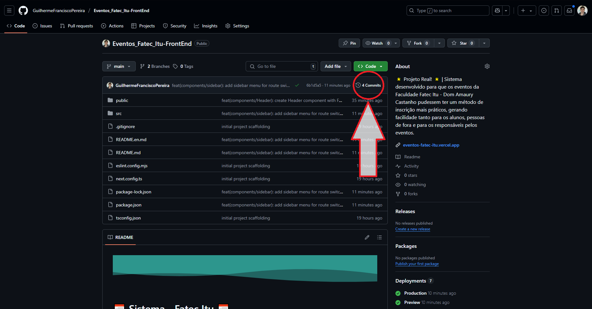
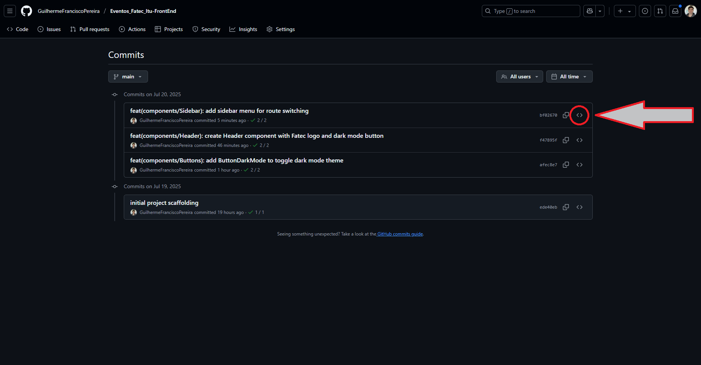
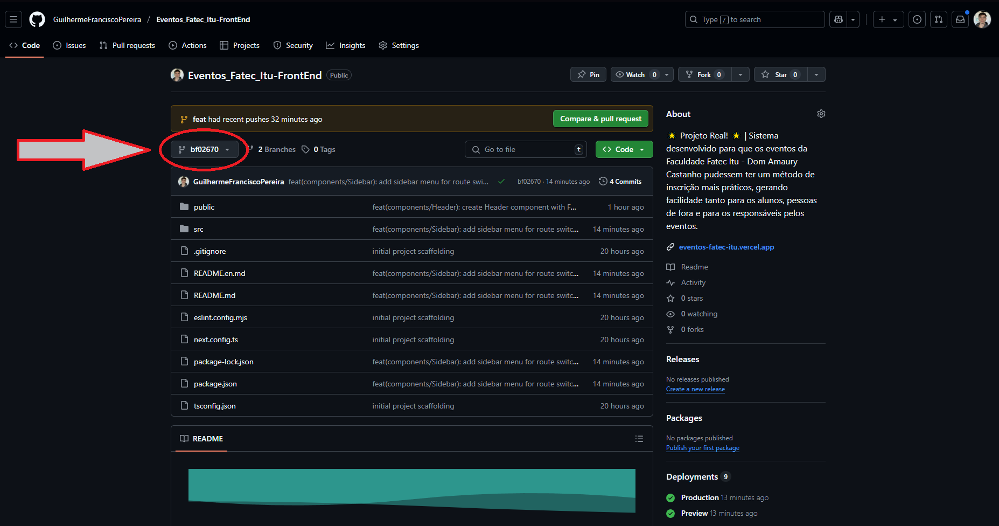
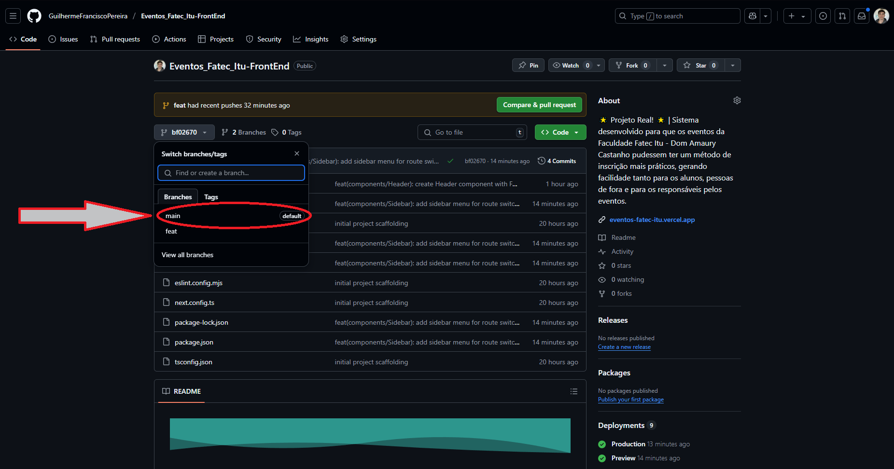

# 📅 Sistema - Fatec Itu 📅

<p align="left">
  <a href="./README.en.md">
    
  </a>
</p>

## ⭐ Repositório Front-End

## 📌 Sobre o projeto

### Este sistema foi desenvolvido para que os eventos da Faculdade Fatec Itu - Dom Amaury Castanho pudessem ter um método de inscrição mais prático, gerando facilidade tanto para os alunos, pessoas de fora e para os responsáveis pelos eventos. Claramente este sistema também é utilizado pelos responsáveis dos eventos, para gerenciamento e controle de eventos, usuários, carrossel, categorias, locais e demais estruturas administrativas. 

### 👥 Este sistema está sendo criado por: Guilherme Francisco Pereira como desenvolvimento de TCC / Sistema real

### ✨ Fato interessante: este é um dos sistemas desenvolvidos exclusivamente por alunos que já está implantado e sendo utilizado ativamente pela faculdade, beneficiando alunos, professores, coordenadores e demais envolvidos!


##


## 🛎️ Atualizações deste commit

### `./src/components/Inputs/InputField:` O rótulo animado dos campos (texto, e-mail, senha e número) fica no alto sempre que houver pelo menos um caractere digitado. Antes ele só ficava no alto quando o valor era válido: num campo de e-mail ainda sem o "@", por exemplo, o rótulo descia ao sair do campo e ficava por cima do texto. Agora ele só volta para o meio quando o campo está vazio, inclusive nos campos opcionais, que antes ficavam com o rótulo no alto mesmo vazios.

### `Lembrar-me no login (./src/hooks/api/Auth/Post/useLogin e ./src/hooks/pages/(public)/Login/useLoginPage):` A caixa "Lembrar-me" da tela de login passou a funcionar: ela é enviada ao back-end como `rememberMe` e, marcada, mantém a pessoa logada por 30 dias sem uso (antes eram sempre 3 dias e a caixa não fazia nada). Cada acesso renova o prazo, então a sessão só termina pelo "Sair", por troca de senha ou de perfil, ou por um novo login da mesma conta.

### `./src/components/Buttons/ButtonDarkMode:` O botão de trocar entre tema claro e escuro ficava cerca de 3px acima do centro do header, porque o desenho do toggle se apoiava na linha de texto do botão e sobrava espaço embaixo. Agora ele é centralizado no próprio botão e fica alinhado com o botão "Entrar" (no celular, também passa a ficar centrado no header).

### `./src/components/Header:` O botão "Entrar" subia 2px no hover, e era só nesse momento que parecia alinhado com o toggle de tema. Agora ele não se move mais: no hover (e no foco pelo teclado) ele fica um pouco mais claro, ganha uma sombra mais forte e um brilho que atravessa o botão, o mesmo efeito usado nos outros botões vermelhos do sistema.


##

## 🖥 Tecnologias Utilizadas
<div align='center'>


</div>

## Versões utilizadas:
    - Next: 15.5.28
    - React: 19.1.0
    - Typescript: 5
    - Docker: 28.3.2

## 🙋🏻‍♂ Como me localizar no projeto?

### Todos os arquivos de código fonte do projeto estão em: `./src`

## 🛈 Como o projeto está estruturado

- `./public:` Pasta que contém os arquivos estáticos que o Next.js serve diretamente da raiz do site, sem passar pelo pipeline de build.
    - `favicon.ico:` ícone do site exibido na aba do navegador, nos favoritos e em dispositivos móveis.
    - `assets:` diretório dentro de public para organizar recursos estáticos adicionais.
        - `images:` subpasta de assets que armazena todas as imagens do projeto (PNG, JPG, SVG), como logos, backgrounds e ícones personalizados.
            - `footer:` Pasta que irá armazenar nossas fotos para utilizar no componente Footer
            - `login:` Pasta que irá armazenar nossas fotos para utilizar nas telas de Login ( Recuperar senha e autenticação em dois fatores )
            - `readme:` Pasta que irá armazenar nossas fotos para utilizar na documentação ( README )

- `./.github/workflows/deploy.yml:` Workflow do GitHub Actions responsável pelo CI/CD do front-end. Ao receber um `git push` na branch `main`, realiza o build da imagem Docker, publica no GitHub Container Registry e atualiza automaticamente o container do front-end na VPS.

- `./Dockerfile:` Arquivo responsável por definir o processo de containerização do front-end. Utiliza Node.js 22 Alpine e build multi-stage para instalar dependências com `npm ci`, gerar o build de produção do Next.js com `npm run build` e executar a aplicação em modo production

- `./.dockerignore` Define quais arquivos e diretórios devem ser ignorados durante o build da imagem Docker.

- `./src/middleware.ts:` Arquivo de middleware de borda que controla o acesso às rotas públicas e privadas com base nos cookies de sessão. Considera tanto o cookie de acesso quanto o cookie de refresh, permitindo que o front-end renove a sessão antes de redirecionar o usuário quando apenas o `access_token` expirou.`

- `./src/@Types:` Armazena as tipagens que são reutilizadas no código
    - `AuditTypes:` Tipagens compartilhadas da tela de Audit (registro resumido, registro detalhado, página da listagem e filtros)
    - `CarouselTypes:` Tipagens compartilhadas da tela de Carousel
    - `CategoriesTypes:` Tipagens compartilhadas da tela de Categories
    - `CertificateTypes:` Tipagens compartilhadas para gestão de certificados automáticos
    - `CoursesTypes:` Tipagens compartilhadas da tela de Courses
    - `EventTypes:` Tipagens compartilhadas da tela de Events
    - `LocationsTypes:` Tipagens compartilhadas da tela de Locations
    - `ParticipantsTypes:` Tipagens compartilhadas da tela de Participants
    - `UsersTypes:` Tipagens compartilhadas da tela de Users
    - `UserJwtProps.ts:` Tipagem de usuário e suas roles.

- `./src/app:` Este é um projeto Next, caso não possua conhecimento em Next procure sobre "App Router Next" para entender mais sobre o projeto e sua estrutura de pastas e rotas! Dentro do app temos: 
  - `globals.css:` Estilizações globais, importado dentro do nosso layout.tsx para passar para toda a aplicação. Define as variáveis de cores dos temas claro e escuro (mantendo o vermelho da Fatec), sombras, cantos, animações e campos de formulário, a fonte que acompanha o tamanho da tela no computador (referência 1536 × 700), o foco visível, a barra de rolagem e o desligamento das animações para quem prefere menos movimento. Também contém a classe `visuallyHidden`, que esconde um texto da tela mas o mantém para leitores de tela e buscadores, e a classe `printSurface`, que força as cores do tema claro no PDF e na impressão.
  - `layout.tsx:` Importa estilos globais e a fonte Poppins, configura os metadados de SEO (título com modelo por página, descrição e Open Graph), adiciona o JSON-LD da organização (Fatec Itu), aplica o tema salvo antes da página aparecer (sem piscar) e encapsula a aplicação.
    - `loading.tsx:` Este é um componente especial do Next.js para exibir algo em carregamento durante o fetch de dados ou mudança de rota, para mostrar isso ao usuário inserimos o nosso componente Loader.
  - `opengraph-image.tsx:` Gera a imagem padrão de compartilhamento (1200 × 630) com o logo da Fatec Itu, usada quando um link do site é enviado em redes sociais ou aplicativos de mensagem.
  - `robots.ts:` Gera o `robots.txt`, liberando as páginas públicas para os buscadores, bloqueando as páginas administrativas e indicando o sitemap.
  - `sitemap.ts:` Gera o `sitemap.xml` com a tela inicial e todos os eventos públicos, atualizado a cada 5 minutos.
  - `(pages):` Possui todas nossas rotas da aplicação, mas lembre-se, sempre que estiver dentro de parentes não será reconhecido como rota aquela pasta! Nossa páginas:
    - `(private):` Tudo que está dentro desta pasta são nossas páginas de rota privada, onde o usuário é obrigado a estar logado para poder acessar. O `layout.tsx` desta pasta marca todas essas páginas para não aparecerem nos buscadores e coloca todas elas dentro do mesmo container centralizado. Nela temos:
        - `AdminPage.module.css:` Estilos compartilhados pelas telas administrativas: o container das páginas, as células da tabela com ícone, título e detalhe, as etiquetas de situação (chips), a barra de progresso das inscrições e os formulários dos modais.
        - `Audit:` Tela de auditoria, visível apenas para ADMIN, com cabeçalho, a tabela de tudo o que acontece no sistema (quando, responsável, o que aconteceu, registro afetado, resultado e detalhe), busca, filtros por resultado, área (os dois com o `InputSelect`) e período dentro de um cartão, linhas de carregamento, paginação e o modal de detalhes `AuditDetailModal`, integrando-se aos hooks de API em: `./src/hooks/api/Audit/` e parte lógica em: `./src/hooks/pages/private/Audit/useAuditPage`
        - `Carousel`: Tela de gerenciamento do carrossel, com cartões de números (cadastradas, aparecendo no site e ocultas), a pré-visualização de cada imagem na proporção do carrossel (4:1), a ordem, a opção de ativar ou ocultar e o ícone para arrastar e mudar a ordem, além de adicionar, editar e apagar fotos, tudo isso integrando-se aos hooks de API em: `./src/hooks/api/Carousel` e parte lógica em: `./src/hooks/pages/private/Carousel/useCarouselPage`
        - `Categories:` Tela de gerenciamento de categorias, montada com o componente `RecordsPage` (cartões de números, busca e tabela), responsável por exibir a lista de categorias cadastradas e oferecer as ações de criar, editar ou excluir cada categoria, integrando-se aos hooks de API em: `./src/hooks/api/Categories/` e parte lógica em: `./src/hooks/pages/private/Categories/useCategoriesPage`
        - `Courses:` Tela de gerenciamento de cursos, montada com o componente `RecordsPage`, responsável por exibir a lista dos cursos cadastrados e oferecer as ações de criar, editar ou excluir cada curso, integrando-se aos hooks de API em: `./src/hooks/api/Courses/` e parte lógica em: `./src/hooks/pages/private/Courses/useCoursesPage`
        - `Events:` Tela de gerenciamento dos eventos, com cartões de números (total, próximos, acontecendo hoje e encerrados), busca, filtro Todos / Próximos / Encerrados e a tabela com a capa do evento, data e horário, local, barra de inscrições, situação (Acontecendo, Hoje, Lotado, Agendado ou Encerrado) e as ações de participantes, página pública, editar e excluir, integrando-se aos hooks de API em: `./src/hooks/api/Events/` e parte lógica em: `./src/hooks/pages/private/Events/useEventsPage`
            - `[id]:` Página dinâmica utilizada para criação e edição de eventos, dividida em seções (Informações principais, Imagem de capa, Público, Local e data, Horário e Descrição), com a imagem de capa na coluna principal e a palavra secreta de presença e o botão de salvar na coluna ao lado. Nela o usuário consegue preencher ou alterar dados como nome, categoria, curso, semestre, limite de inscrições, local, data, horários, palestrante, descrição, imagem, regras de restrição do evento e palavra secreta para validação de presença.
            - `Participants:` Página que mostra quais são os participantes do evento desejado, com o nome, data e local do evento no topo, cartões de inscritos, presentes, ausentes e taxa de presença, busca, a tabela com nome, e-mail, RA, data de inscrição e a opção para marcar a presença, e os botões para exportar em PDF e imprimir.
        - `Locations:` Tela de gerenciamento de locais, montada com o componente `RecordsPage`, responsável por exibir a lista dos locais cadastrados e oferecer as ações de criar, editar ou excluir cada local, integrando-se aos hooks de API em: `./src/hooks/api/Locations/` e parte lógica em: `./src/hooks/pages/private/Locations/useLocationsPage`
        - `Users:` Tela de gerenciamento de usuários, com cartões por perfil (administradores, coordenadores e auxiliares docentes), busca e a tabela com foto ou iniciais, e-mail e perfil em destaque, oferecendo as ações de criar, editar ou excluir cada usuário, integrando-se aos hooks de API em: `./src/hooks/api/Users/` e parte lógica em: `./src/hooks/pages/private/Users/useUsersPage`
    - `(public):` Tudo que está dentro desta pasta são nossas páginas de rota pública, onde mesmo sem estar logado o usuário pode acessar. Nela temos:
        - `page.tsx`: Nossa primeira página, também conhecido como o nosso "home", é a tela em que o usuário visualiza assim que acessa o site: carrossel, o título "Agenda de eventos da Fatec Itu", os filtros e os cards dos eventos.
        - `Home.module.css:` Estilos do cabeçalho da agenda na tela inicial (título com a palavra "eventos" sublinhada com animação e subtítulo).
        - `EventDetail:` Tela para mostrar o evento com mais detalhes aos usuários não autenticados, possibilitando também que se inscrevam no evento. O `page.tsx` gera no servidor o título, a descrição, a imagem de compartilhamento e o JSON-LD do evento para buscadores e redes sociais, e o `EventDetailView.tsx` contém a tela: trilha de navegação, capa com título, categoria e palestrante (no computador a foto aparece inteira, com as sobras preenchidas por uma versão desfocada da própria imagem), os painéis "Sobre o evento" e "Quem pode participar", o cartão com data, horário, local, vagas (só para quem está logado) e o botão de inscrição, o esqueleto de carregamento e o aviso de evento não encontrado.
        - `Login:` Tela de login, ao acessar: /Login, montada com o componente `AuthShell`. O `layout.tsx` desta pasta marca o login e a troca de senha para não aparecerem nos buscadores. Solicita e-mail e senha para o usuário acessar a plataforma, caso o e-mail e senha estejam correto o usuário troca para o stage de 'confirm' onde insere os 6 digitos enviado ao e-mail para acessar ( 2FA )
            - `ResetPassword:` Tela para o usuário trocar de senha, ao acessar: /Login/ResetPassword, também com o `AuthShell`. Solicita primeiro o e-mail e, exista ele ou não, avança para a etapa da nova senha mostrando a mensagem neutra da API, para não revelar quais e-mails têm conta. Depois o usuário informa a nova senha, confirma e insere o código de 6 dígitos enviado ao e-mail.
        - `Verification:` Tela de verificação de certificado, ao acessar: /Verification/[token], link presente no QR Code do certificado. Mostra em um cartão, com ícone de situação, os dados do certificado para confirmar que ele é autêntico. O `layout.tsx` desta pasta marca a página para não aparecer nos buscadores, já que ela exibe o nome e o e-mail do aluno.

- `./src/components:` Onde está os componentes que serão reutilizados em diversas partes do código. Neste projeto temos os components:
    - `AuditDetailModal:` Modal com todos os detalhes de um registro de auditoria: responsável na ocasião, data e hora de Brasília, registro afetado, resultado, operação, IP, navegador, a tabela do que mudou e os dados anteriores, posteriores, enviados e a resposta. Fecha pelo botão, pela tecla Esc ou clicando fora e devolve o foco a quem o abriu.
    - `AuthShell:` Layout das telas de login e troca de senha: painel da marca com ilustração, o selo "Área dos colaboradores" e os destaques do sistema de um lado e o cartão com o formulário e o logo do outro.
    - `Buttons:`
        - `Button:` Botão padrão do sistema com as variações principal, secundária, discreta e de perigo, três tamanhos, ícone antes ou depois do texto, largura total e um brilho que atravessa o botão ao passar o mouse. Com a prop `href` vira um link.
        - `ButtonDarkMode:` Botão responsável por cuidar do dark mode do site ( modo claro / escuro ).
        - `ButtonRay:` Botão que é reutilizado em diversas partes do código, alterando o texto e etc com base nas props. Agora com fundo em degradê e brilho ao passar o mouse.
        - `ButtonScrollToTop:` Botão flutuante fixado no canto inferior da tela que permite ao usuário retornar suavemente ao topo da página.
        - `IconButton:` Botão só com ícone usado nas ações das tabelas (editar, excluir, ver participantes etc.), com nome para leitores de tela, dica ao passar o mouse ou focar pelo teclado e cores por tipo de ação.
    - `CardEvents:` Cards que mostram os eventos aos usuários não autenticados, mostram apenas os eventos que ainda não ocorreram, com a capa em 16:9, selo da data, selo "Exclusivo Fatec", categoria, data e horário, local, palestrante, barra de vagas (só para quem está logado) e animações ao passar o mouse e ao aparecer na tela. Mostra cards de carregamento enquanto busca os eventos e uma mensagem quando nenhum evento combina com os filtros.
    - `CarouselComponent:` Componente do carrossel que aparece na tela inicial apresentando as imagens escolhidas pelos administradores / coordenadores, em 4:1 (2,2:1 no celular), com setas, indicadores, pausa ao passar o mouse e zoom suave na imagem. Não aparece quando não há imagens ativas.
    - `CodeInputValidation:` Componente reutilizável com 6 caixinhas para o 2fa, tanto para confirmar login quando para resetar a senha. Aceita colar o código inteiro (Ctrl+V) em qualquer caixa, ignorando espaços, traços e textos junto com os números
    - `EmptyState:` Aviso padrão de lista vazia ou conteúdo não encontrado, com ícone, título, descrição e uma ação opcional.
    - `Footer:` Rodapé escuro com o logo todo em branco (inclusive o "Itu", que na imagem original é vermelho) e a descrição da agenda, redes sociais, contato (telefone, horário de funcionamento e endereço), links úteis para os alunos e o logo do Governo de SP.
    - `Header:` Componente que fica fixo em todas as páginas pois foi inserido dentro de `layout.tsx` e fica localizado ao topo superior do site, com efeito de vidro e sombra ao rolar a página. Em telas não mobile ele também é responsável por exibir a navegação principal centralizada com suporte à dropdown e subdropdown por hover (o clique não mantém o menu aberto; pelo teclado ele abre com Tab) e o menu do usuário logado (foto, nome, perfil, "Gerenciar perfil" e "Sair"). Entre 1151 px e 1366 px os itens ficam mais compactos para que todos os itens do administrador caibam sem cobrir o logo ou o menu do usuário. O logo fica alinhado ao centro da altura do header.
    - `ImageCloudinary:` Responsável por renderizar imagens hospedadas no Cloudinary de forma otimizada com a tag Image do next, tornando um componente que pode ser reutilizável em qualquer local, fazendo a imagem ficar 100% dentro do elemento pai de forma correta. As props `fit` e `position` controlam o `object-fit` (preencher por padrão) e o ponto de foco, para a imagem nunca ficar esticada.
    - `ImageCropper:` Editor de recorte de imagem aberto por cima da tela, com as opções de recorte no tamanho recomendado, livre, 16:9, 4:3 e quadrado. Mostra o tamanho do recorte, avisa quando a resolução ou a proporção não são as ideais e marca a área visível no celular.
    - `Inputs:`
        - `FiltersHome:` Filtros combináveis para os eventos, filtros para filtrar por nome dos eventos, por categorias e por datas com base em inicio e fim, dentro de um cartão com o botão "Limpar". Em celulares estreitos os campos de data ficam um embaixo do outro. Este componente de filtros é utilizado em CardEvents
        - `InputCheckbox:` Input de checkbox que é reutilizável no código para campos booleanos, com o ✓ centralizado na caixa. Com a prop `label` vira um cartão com borda que fica vermelho quando marcado
        - `InputField:` Input reutilizável alterando os dados com base nas props recebidas, com o rótulo centralizado no campo vazio, que sobe letra por letra ao focar ou preencher o campo
        - `InputImage:` Permite selecionar imagens por clique, arrastar e soltar ou colar. Exibe pré-visualização local ou de URL existente (sem cortar nem esticar a imagem), indica visualmente quando um arquivo é arrastado e oferece botão para remover a imagem, habilitado apenas quando há arquivo selecionado. Com a prop `recommendedSize`, a pré-visualização segue a proporção recomendada (16:6 no evento e 4:1 no carrossel), exibe o tamanho recomendado da imagem, indica se a imagem escolhida está no tamanho ideal e permite recortá-la com o `ImageCropper`
        - `InputMultiSelect:` Componente customizado e reutilizável de seleção múltipla, permitindo escolher nenhum, um ou vários valores por meio de dropdown com checkboxes. Possui opção "Todos" quando nenhum item está selecionado, exibe os valores escolhidos no campo, fecha automaticamente ao clicar fora ou com a tecla Esc (sem fechar o modal em que está) e conta com suporte a label, placeholder, estado desabilitado, opções dinâmicas e className personalizada. A lista abre por cima da página com o `useFloatingDropdown`, sem ser cortada por modais ou seções, e aceita navegação com as setas.
        - `InputSelect:` Componente customizado de select reutilizável, permitindo substituir o uso de `<select>` nativo por uma interface padronizada no projeto, com suporte a label, placeholder, estado desabilitado e opções dinâmicas. Nomes longos quebram linha na lista e a tecla Esc fecha só a lista aberta. A lista abre por cima da página com o `useFloatingDropdown`, sem ser cortada por modais ou seções, vira para cima quando falta espaço embaixo e aceita navegação com as setas.
        - `SearchInput:` Campo de busca das telas administrativas, com ícone de lupa, rótulo para leitores de tela e botão para limpar o texto.
    - `Loader:` Componente que mostra ao usuário que algo está carregando, com fundo desfocado cobrindo a tela inteira
    - `Modal:` É como uma "janela" sobreposta à interface principal que bloqueia a interação com o conteúdo de fundo até ser fechada ou confirmada, usada para exibir informações críticas ou solicitações de ação específicas. Tem fundo desfocado, ícone no título, botões Cancelar e Confirmar, fecha com Esc, foca o primeiro campo ao abrir, confirma com Enter, trava a rolagem da página e no celular vira um painel que sobe da parte de baixo da tela.
    - `PageHeader:` Cabeçalho das telas administrativas com ícone, título, descrição e os botões de ação da tela.
    - `RecordsPage:` Tela completa de cadastros simples, usada por Categorias, Cursos e Locais: cabeçalho, cartões com o total, os criados nos últimos 30 dias e a última edição, busca e a tabela com as ações de editar e excluir.
    - `Reveal:` Mostra o conteúdo com uma animação de subida quando ele entra na tela durante a rolagem, com atraso opcional para animar itens em sequência.
    - `Sidebar:` Menu lateral utilizado apenas em telas mobile para o usuário conseguir trocar de rotas de uma maneira mais acessível sem ocupar tanto espaço de tela, incluindo suporte à submenu e subsubmenu com base na mesma configuração de navegação compartilhada utilizada no Header. Mostra o cartão do usuário logado, os botões "Gerenciar perfil" e "Sair", fecha com Esc e trava a rolagem da página enquanto está aberto.
    - `StatCard:` Cartão com um número da tela (ícone, rótulo, valor e detalhe), com cores por tipo e estado de carregamento. O `StatGrid` organiza os cartões em grade.
    - `Table:` Tabela reutilizável, apenas precisa passar as colunas, os dados, e as colunas ocultas no mobile. Mostra linhas de carregamento, uma barra de progresso quando está atualizando e uma mensagem quando está vazia; no celular (até 640 px) cada linha vira um cartão. O `TableToolbar` reúne a busca, os filtros e o contador acima da tabela.
    - `Toast:` Exibe notificações breves. Pode ser reutilizado em diferentes cenários mudando apenas as props de mensagem e tipo (Success, Alert, Error). Aparece em um cartão no canto inferior com ícone colorido por tipo e botão de fechar.
    - `UserAvatar:` Foto do usuário (Cloudinary) ou, quando não tem foto, as iniciais do nome, em três tamanhos.

- `./src/hooks:` Armazenaremos aqui os nossos hooks personalizados com as partes lógicas da aplicação, nós separamos os nossos hooks, por tipos como: pages, components e api.
    - `api`:` Aqui ocorrem os métodos HTTP fazendo requisições para o back-end
        - `client.ts:` Cliente centralizado para requisições autenticadas. Ele envia cookies automaticamente, busca token CSRF quando necessário, intercepta respostas `401`, chama a rota de refresh, atualiza o usuário autenticado na store e refaz a requisição original uma vez.
        - `Audit:` Todas as requisições para o back-end nas rotas de /audit/
            - `Get:` Requisições GET nas rotas de /audit/
                - `useGetAuditLogs:` Busca a lista paginada de registros de auditoria com busca, resultado, área e período, avisando e levando para a tela inicial quem não tem permissão.
                - `useGetAuditLogById:` Busca todos os detalhes de um registro de auditoria para o modal.

        - `Auth:` Todas as requisições para o back-end nas rotas de /auth/
            - `Get:` Requisições GET nas rotas de /auth/
                - `getMe:` Utilizado para pegar com o back-end os dados do usuário, como nome, e-mail, role e etc, usando o cliente centralizado para respeitar o refresh automático da sessão.
            - `Post:` Requisições POST nas rotas de /auth/
                - `useLogin:` Requisições para o back-end para fazer a solicitação de login (gerar código 2fa) e confirmar código 2fa para entrar na conta
                - `useLogout:` Bate na rota de logout para permitir o usuário a se deslogar 
                - `useResetPassword:` Requisições para o back-end para fazer a solicitação de troca de senha (gerar código 2fa) e confirmar código 2fa para trocar a senha. Guarda a mensagem neutra devolvida pela API para mostrar na tela.

        - `Carousel:` Todas as requisições para o back-end nas rotas de /carousel/
            - `Delete:` Requisições DELETE nas rotas de /carousel/delete/:id
                - `useDeleteCarousel.ts:` Hook que encapsula a lógica de remover um slide, enviando DELETE com proteção CSRF e tratando falhas para exibir mensagens de erro.
            - `Get:` Requisições GET nas rotas de /carousel
                - `useGetAllCarousels.ts:` Hook responsável por carregar todos os slides, gerenciar estados de “loading” e “error” e expor uma função refetch() para recarregar os dados após operações de mutação.
            - `Post:` Requisições POST nas rotas de /carousel/create
                - `useCreateCarousel.ts:` Hook que constrói um FormData com título, ordem, status e imagem, faz a chamada POST com CSRF e dispara toasts de sucesso ou falha.
            - `Patch:` Requisições PATCH nas rotas de /carousel/patch/:id
                - `useEditCarousel.ts:` Hook para atualização completa de um slide (nome, ordem, ativo, imagem), alternando entre multipart/form-data e JSON conforme a presença de arquivo e incluindo CSRF e tratamento de exceções. O mesmo arquivo exporta o `useReorderCarousel`, que muda apenas a ordem de um slide, e o `useToggleActiveCarousel`, que bate na rota /carousel/patch/toggle/ para inverter apenas o campo isActive via PATCH JSON com CSRF, exibindo toast indicando “ativado” ou “desativado”.

        - `Categories:` Todas as requisições para o back-end nas rotas de /categories/
            - `Delete:` Requisições DELETE nas rotas de /categories/delete/
                - `useDeleteCategory.ts:` Hook que encapsula a lógica de requisição HTTP para excluir uma categoria específica, enviando um DELETE protegido por CSRF e garantindo o tratamento de erros para informar falhas de exclusão.
            - `Get:` Requisições GET nas rotas de /categories/
                - `useGetAllCategories.ts:` Hook que realiza a recuperação de toda a lista de categorias via requisição GET, gerenciando estados de carregamento, erro e permitindo refetch após operações de CRUD.
            - `Patch:` Requisições PATCH nas rotas de /categories/patch/:id
                - `useEditCategory.ts:` Hook responsável por enviar atualizações parciais de dados de uma categoria existente através de uma requisição PATCH com CSRF, permitindo modificar apenas o nome da categoria.
            - `Post:` Requisições POST nas rotas de /categories/post/
                - `useCreateCategory.ts:` Hook para criar uma nova categoria no sistema via requisição POST, construindo o payload tipado com o nome da categoria e incluindo proteção CSRF para garantir a segurança da operação.

        - `Certificate:` Todas as requisições para o back-end nas rotas de /certificates/
            - `Get:` Requisições GET nas rotas de /certificates/
                - `useGetVerifyCertificate.ts:` Hook responsável por validar publicamente um certificado a partir do token informado na URL, consultando o back-end para verificar autenticidade, recuperar os dados do certificado e controlar os estados de carregamento e ausência de resultado.

        - `Courses:` Todas as requisições para o back-end nas rotas de /courses/
            - `Delete:` Requisições DELETE nas rotas de /courses/delete/
                - `useDeleteCourses.ts:` Hook que encapsula a lógica de requisição HTTP para excluir um curso específico, enviando um DELETE protegido por CSRF e garantindo o tratamento de erros para informar falhas de exclusão.
            - `Get:` Requisições GET nas rotas de /courses/
                - `useGetAllCourses.ts:` Hook que realiza a recuperação de toda a lista de cursos via requisição GET, gerenciando estados de carregamento, erro e permitindo refetch após operações de CRUD. Também expõe uma listagem pública para seleção e uso em formulários do sistema.
            - `Patch:` Requisições PATCH nas rotas de /courses/patch/:id
                - `useEditCourses.ts:` Hook responsável por enviar atualizações parciais de dados de um curso existente através de uma requisição PATCH com CSRF, permitindo modificar o nome do curso.
            - `Post:` Requisições POST nas rotas de /courses/create
                - `useCreateCourses.ts:` Hook para criar um novo curso no sistema via requisição POST, construindo o payload tipado com o nome do curso e incluindo proteção CSRF para garantir a segurança da operação.

        - `Events:` Todas as requisições para o back-end nas rotas de /events/
            - `Delete:` Requisições DELETE nas rotas de /event/delete/:id
                - `useDeleteEvent.ts:` Hook que encapsula a lógica de remover um evento, enviando DELETE com proteção CSRF e tratando falhas para exibir mensagens de erro.
            - `Get:` Requisições GET nas rotas de /event
                - `useGetAllEvents.ts:` Responsável por carregar todos os eventos. A listagem pública também informa quando ainda está carregando, para a tela inicial mostrar os cards de carregamento.
                - `useGetEventById.ts:` Busca os dados públicos de um evento pelo id para a tela de detalhe, informando quando ainda está carregando e avisando com um toast quando não consegue carregar.
                - `useGetAvailabilityDates.ts:` Responsável por pegar do banco de dados todos os dias que possuem pelo menos 1 horário disponível no local escolhido para o evento, evitando de ter dois eventos no mesmo local.
                - `useGetAvailabilityTimes.ts:` Responsável por pegar do banco de dados todos os horários disponíveis para não ocorrer que um evento sobreponha outro no mesmo dia, horário e local.
            - `Patch:` Requisições PATCH nas rotas de /event/patch/:id
                - `useEditEvent.ts:` Hook para editar um evento por completo, podendo substituir os valores.
            - `Post:` Requisições POST nas rotas de /event/create
                - `useCreateEvent.ts:` Responsável por criar um novo evento, fazendo a requisição para o back-end passando os valores corretos

        - `Locations:` Todas as requisições para o back-end nas rotas de /locations/
            - `Delete:` Requisições DELETE nas rotas de /locations/delete/:id
                - `useDeleteLocation.ts:` Hook que encapsula a lógica de requisição HTTP para excluir um local específico, enviando um DELETE protegido por CSRF e tratando falhas para informar ao usuário quando a exclusão não puder ser concluída.
            - `Get:` Requisições GET nas rotas de /locations/
                - `useGetAllLocations.ts:` Hook responsável por recuperar a lista completa de locais cadastrados no sistema, gerenciando estados de carregamento, armazenamento dos dados e possibilidade de refetch após operações de CRUD. Também expõe a listagem pública para uso dinâmico em formulários e interfaces que dependem da seleção de locais.
            - `Patch:` Requisições PATCH nas rotas de /locations/patch/:id
                - `useEditLocation.ts:` Hook responsável por enviar atualizações parciais de um local existente através de uma requisição PATCH com proteção CSRF, permitindo modificar o nome do local cadastrado.
            - `Post:` Requisições POST nas rotas de /locations/create
                - `useCreateLocation.ts:` Hook para criar um novo local no sistema via requisição POST, enviando o nome do local ao back-end com proteção CSRF e tratamento de erros.
        
        - `Participants:` Todas as requisições para o back-end nas rotas de /participants/
            - `Get:` Requisições GET nas rotas de /participants/
                - `useGetAllParticipants:` Retorna todos os participantes de um determinado evento com base no id do evento que vem através da props
            - `Patch:` Requisições PATCH nas rotas de /participants/patch/:id
                - `useEditParticipant:` Atualiza o campo isPresent ( boolean ) da tabela Participant com base no ID do evento e dentro deste evento o ID do participante, assim atualizando conforme o usuário atualiza o checkbox no front
            - `Post:` Requisições POST nas rotas de /participants/create
                - `useCreateParticipant:` Responsável por adicionar uma nova pessoa à um evento especifico, fazendo a requisição para o back-end
        
        - `Users:` Todas as requisições para o back-end nas rotas de /users/
            - `Delete:` Requisições DELETE nas rotas de /users/delete/
                - `useDeleteUser.ts:` Hook que encapsula a lógica de requisição HTTP para excluir um usuário específico, enviando um DELETE protegido por CSRF e garantindo o manuseio de erros para informar falhas de exclusão.
            - `Get:` Requisições GET nas rotas de /users/
                - `useGetAllUsers.ts:` Hook que realiza a recuperação de toda a lista de usuários via requisição GET, gerenciando estados de carregamento, erro e atualizando automaticamente a rota caso o usuário não esteja autorizado.
            - `Patch:` Requisições PATCH nas rotas de /users/patch/
                - `useEditPersonalProfile:` Hook que possibilita trocar o nome e a foto do próprio perfil.
                - `useEditUser.ts:` Hook responsável por enviar atualizações parciais de dados de um usuário existente através de uma requisição PATCH com CSRF, permitindo modificar nome, e-mail, senha ou nível de acesso.
            - `Post:` Requisições POST nas rotas de /users/post/
                - `useCreateUser.ts:` Hook para criar um novo usuário no sistema via requisição POST, construindo o payload tipado com nome, e-mail, senha e cargo, e incluindo proteção CSRF para garantir a segurança da operação.

    - `components:`
        - `Buttons`: Partes lógicas dos nossos componentes de botões
            - `useButtonDarkMode:` Responsável por lidar com o dark mode, mudando o tema com base no click do usuário!
        - `CarouselComponent:`
            - `useCarouselComponent:` Parte lógica do carrossel, lida com o passar de imagens automático (a cada 8 segundos) ou manual pelas setas, clique nos indicadores que estão centralizados na parte inferior, pausa ao passar o mouse e etc.
        - `CodeInputValidation:` 
            - `useCodeInputValidation:` Lida com a parte lógica dos inputs da autenticação em dois fatores, incluindo distribuir pelas caixas os dígitos de um código colado
        - `useFloatingDropdown:` Posiciona as listas do `InputSelect` e do `InputMultiSelect` na tela, fora do campo, com a largura do campo: abre embaixo ou em cima conforme o espaço disponível, acompanha a rolagem e o fim das animações e foca a primeira opção quando a lista é aberta pelo teclado.
        - `useManageProfile:` Abre o modal "Gerenciar perfil" para trocar o nome e a foto do próprio usuário, usado tanto pelo menu do usuário no Header quanto pelo Sidebar.
        - `useTableSearch:` Filtra a lista de uma tabela pelo texto digitado na busca, sem diferenciar maiúsculas, minúsculas e acentos.
    
    - `pages:` Lógicas das páginas, arquivos page.tsx que fica dentro de app
        - `(private):` Partes lógicas das páginas de rotas privadas (pages/private)
            - `Audit:`
                - `useAuditPage:` Partes lógicas à serem usadas no page de Audit: filtros, busca com espera de 400 ms, paginação e abertura do modal de detalhes
            - `Carousel:`
                - `useCarouselPage:` Partes lógicas à serem usadas no page de Carousel
            - `Categories:`
                - `useCategoriesPage:` Partes lógicas à serem usadas no page de Categories
            - `Courses:`
                - `useCoursesPage:` Partes lógicas à serem usadas no page de Courses
            - `Events:`
                - `id:`
                    - `/useEventForm:` Todas as partes lógicas da tela de criação ou edição de eventos
                - `useEventsPage:` Partes lógicas à serem usadas no page de Events
            - `Locations:`
                - `useLocationsPage:` Partes lógicas à serem usadas no page de Locations
            - `Users:`
                - `useUsersPage:` Partes lógicas à serem usadas no page de Users
        - `(public):` Partes lógicas das páginas de rotas públicas (pages/public)
            - `EventDetail:`
                - `id:`
                    - `useEventDetailPage:` Partes lógicas à serem usadas no page de EventDetail
            - `Login:`
                - `useLoginPage:` Partes lógicas à serem usadas no page de Login
                - `useResetPasswordPage:` Partes lógicas à serem usadas no page de ResetPassword

- `./src/stores:` Stores para a biblioteca Zustand
    - `ZustandWrapper:` Junta todos os components do Zustand para compartilharmos de uma única forma para o layout.tsx
    - `useModalStore:`
        - `index.ts:` Controlar a exibição e limpa os dados do modal da aplicação.
    - `useToastStore:`
        - `index.ts:` Responsável por orquestrar a exibição, animação de progresso e fechamento automático dos toasts em toda a aplicação.
    - `useUserStore:`
        - `index.ts:` Para setar o usuário na aplicação

- `./src/utils:` Pasta que agrupa funções utilitárias genéricas, sem dependência de componentes específicos, usadas em toda a aplicação para operações comuns de DOM e exportação.
    - `apiErrorMessage:` Monta a mensagem de erro devolvida pela API: os erros de validação ficam um em cada linha (o Toast e o Modal mostram as quebras de linha) e, quando a API não informa nada, usa a mensagem padrão de cada tela.
    - `auditLabels:` Traduz para português as ações, áreas, resultados, perfis e campos da auditoria e formata os valores (datas em horário de Brasília, horários dos eventos, sim/não, listas e valores protegidos).
    - `downloadSectionAsPdf:` Função que captura uma seção da página (identificada por ID) e gera um arquivo PDF com toda a sua extensão, incluindo quebras de página em A4, sempre com as cores do tema claro. Serve para permitir ao usuário baixar qualquer parte da interface como documento portátil.
    - `fatecRa:` Tira pontos, traços e espaços do RA e valida o RA da Fatec (13 números com unidade, curso, ano e semestre de ingresso, turno e matrícula) com a mesma regra da API, para o aluno ver o erro antes de enviar a inscrição.
    - `formatDate:` Funções de data usadas nas telas: separa a data e o horário dos eventos, verifica se uma data está dentro dos últimos dias, escreve datas relativas e retorna a hora atual no mesmo padrão em que os horários dos eventos são salvos, para calcular a situação de cada evento.
    - `imageCrop:` Centraliza os tamanhos recomendados das imagens de eventos e do carrossel e as funções que recortam a imagem em canvas e geram o arquivo final enviado à API.
    - `localDate:` Retorna a data de hoje no fuso horário do usuário no formato `AAAA-MM-DD`, usada como data mínima nos campos de data. O `toISOString()` usa UTC e, no Brasil, depois das 21h já retornava a data do dia seguinte.
    - `navigationData:` Arquivo responsável por centralizar a configuração dos itens de navegação reutilizados no Header e no Sidebar, incluindo rotas internas, links externos, dropdown, subdropdown e controle de visibilidade com base na role do usuário. O item Auditoria aparece apenas para ADMIN.
    - `printSection:` Função que clona e prepara uma seção da página (identificada por ID) para impressão, centralizando-a e aplicando margens, mantendo cores exatas do cabeçalho da tabela e as cores do tema claro mesmo quando o site está no escuro. Serve para acionar o diálogo de impressão do navegador e imprimir apenas o conteúdo desejado.
    - `seo:` Centraliza a URL e a descrição do site, os dados da Fatec Itu usados no JSON-LD, a busca dos eventos públicos no servidor (com tempo limite, para a página não travar se a API demorar) e a montagem dos metadados e do JSON-LD de cada evento.
    - `wrapperVLibras:` Componente utilitário cliente responsável por inicializar globalmente a integração com o plugin VLibras dentro da aplicação. Serve para disponibilizar o recurso de acessibilidade de tradução para Libras em todas as páginas ao ser importado no `layout.tsx`.

## ❔ Como rodar o projeto na minha máquina?

- O projeto pode ser executado de duas formas, ambas vão ser ensinadas abaixo:
    - Localmente, rodando o código na sua máquina.
    - Via Docker, subindo o front-end em container mas não se esqueça de no meu github também pegar o back-end.

- Antes de tudo, você precisa ter o Git instalado no seu computador. O Git é uma ferramenta que permite clonar e gerenciar repositórios de código.
    - Windows: Baixe o Git <a href="https://git-scm.com/download/win" target="_blank">aqui</a> e siga as instruções de instalação.
    - macOS: Você pode instalar o Git <a href="https://git-scm.com/download/mac" target="_blank">aqui</a> ou usando o Homebrew com o comando brew install git:
        ```bash
        brew install git
        ```
        
    - Linux: Use o gerenciador de pacotes da sua distribuição, por exemplo para Debian/Ubuntu:
        ```bash
        sudo apt install git
        ```

- Abra o terminal (no Windows, você pode usar o Git Bash, que é instalado junto com o Git).

- Navegue até o diretório onde deseja armazenar o projeto.

- Execute o comando para clonar o repositório:

    ```bash
    git clone https://github.com/GuilhermeFranciscoPereira/Eventos_Fatec_Itu-Front-End.git
    ```

- Após clonar o repositório, navegue até a pasta do projeto
    ```bash
    cd Eventos_Fatec_Itu-Front-End
    ```

- Agora você pode abrir os arquivos do projeto com seu editor de texto ou IDE preferido. Exemplo do vsCode: 
    ```bash
    code .
    ```

- 🚨 Não esqueça que para não ocorrer erros no código ao clonar ele, você deve fazer o comando abaixo 🚨
    ```bash
    npm i   
    ```

- Ao ter o projeto na sua máquina você deve abrir o site. Para isso siga os passos abaixo:
    - Abra o terminal e escreva o código abaixo para iniciar o site:
      ```bash
      npm run dev
      ```

    - ⚠️ Lembre-se de criar o arquivo .env com base em tudo que contém no arquivo: `.env.example`

##

## 🐳 Comandos Docker

### O Dockerfile do front-end utiliza build multi-stage com três etapas:

- `deps:` Instala as dependências do projeto com `npm ci` a partir dos arquivos `package.json` e `package-lock.json`.
- `builder:` Copia os arquivos do projeto, reutiliza as dependências instaladas e executa o build de produção com `npm run build`.
- `runner:` Prepara o ambiente final de produção, copia os arquivos necessários do build e inicia a aplicação Next.js na porta `4001`.

### Após criar o `Dockerfile` e configurar o serviço no `docker-compose.yml`, gere a imagem e rode o container:
``` bash
docker-compose up --build -d
```

### Isso vai:
- Gerar a imagem Docker do front-end
- Iniciar a aplicação Next.js
- Mapear a porta configurada no docker-compose.yml

### Verifique se o container está mesmo up e com a porta mapeada

```bash
docker-compose ps
```

### Abre na porta que estiver aparecendo, por exemplo:

```bash
http://localhost:4001
```

### Para reiniciar o frontend quando mudar o código:

```bash
docker-compose restart frontend_events-fatec-itu
```

### Parar só o frontend

```bash
docker-compose stop frontend_events-fatec-itu
```

##

## ⚠️ Informações importantes sobre o projeto ⚠️

### 📝 Todos os commits do projeto possuem um readme detalhado do que foi feito naquele commit como mostrado de exemplo na imagem abaixo, então caso deseje ver o processo de criação do código viaje pelos commits e veja as informações!

## 

##

### ❔ Como fazer isso? 

### 👇🏻 Para você ver o processo de criação e o que foi feito em cada commit siga o passo-a-passo:

##

### 1 - Nesta mesma guia em que você está, suba a tela até encontrar embaixo do botão verde o local em que está circulado da foto abaixo e então clique nele


##

### 2 - No lado direito dos commits você encontra um simbolo de <> como está circulado na foto abaixo e então você clica neste simbolo e irá encontrar como o código estava naquele momento e o readme detalhado daquele momento!


##

### 3 - Depois de encontrar tudo que deseja, caso queira voltar o commit atual, você irá clicar no local em que a imagem a baixo circula:


##

### 4 - E então clique em main ( onde está circulado na foto abaixo ) e voltará para o último commit realizado!


##

## 🎉 É isso! Esse é o sistema da Fatec Itu para eventos, caso tenha ficado com alguma dúvida ou deseje complementar algo diretamente comigo você pode estar entrando em contato através do meu LinkedIn:
> Link do meu LinkedIn: <a href="https://www.linkedin.com/in/guilherme-francisco-pereira-4a3867283" target="_blank">https://www.linkedin.com/in/guilherme-francisco-pereira-4a3867283</a>

### 🚀 Obrigado pela atenção e espero que tenha gostado do que tenha visto aqui, que tal agora dar uma olhada nos meus outros repositórios? 👋🏻

#

### ❤️ Créditos:

#### Créditos primários à Faculdade de Tecnologia de Itu por ceder seu nome, e utilizar o sistema em seu ambiente!
> <a href="https://fatecitu.cps.sp.gov.br" target="_blank">https://fatecitu.cps.sp.gov.br</a>

#### Créditos dos emojis: 
> <a href="https://emojipedia.org" target="_blank">https://emojipedia.org</a>

#### Créditos dos badges: 
> <a href="https://shields.io" target="_blank">https://shields.io</a>
